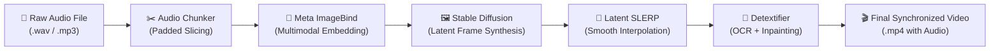

# Music to Image Interpolation

> **Generative cross-modal pipeline transforming audio tracks into visually synchronized video interpolations via Meta's ImageBind and Stable Diffusion.**

[](https://colab.research.google.com/github/gio961gio/Music-to-Image-Interpolation/blob/main/Music_to_Image_Interpolation_.ipynb)
[](https://www.python.org/)
[](https://pytorch.org/)
[](https://huggingface.co/docs/diffusers)
[](https://github.com/facebookresearch/ImageBind)

---

## 🎨 Overview

**Music-to-Image-Interpolation** is an end-to-end multimodal generative pipeline that creates evolving, continuous video interpolations directly from raw musical compositions. By bridging the auditory and visual domains through **Meta's ImageBind** multimodal embedding space and **Stable Diffusion**, the system translates acoustic dynamics, timbres, and phrases into semantically coherent and fluidly morphing visual scenes.

Key capabilities:
- **Audio-to-Visual Projection:** Converts audio chunks into joint embedding vectors using Meta's ImageBind, capturing acoustic moods and semantic textures without relying on manual text prompts.
- **Latent Spherical Linear Interpolation (SLERP):** Generates smooth, seamless visual transitions between musical phrases in diffusion latent space, avoiding jarring frame jumps.
- **Automated Text Artifact Removal (Detextifier):** Utilizes OCR (Tesseract) and inpainting to detect and eliminate pseudo-text artifacts frequently generated by diffusion models.
- **Cloud-Ready Workflow:** Fully executable directly in Google Colab with single-click setup and automated dependency resolution.

---

## 🎬 Video Demonstrations

Click on any demo below to watch the generated audio-visual interpolations:

| Musical Piece | Composer / Style | Parameters | Video Showcase |
| :--- | :--- | :--- | :---: |
| **Music for Pieces of Wood** | Steve Reich (Minimalism) | 30s extract · `fps=7` · `steps=20` | [▶️ Watch Video](https://github.com/gio961gio/Music-to-Image-Interpolation/assets/163283326/b822079f-1638-4ac5-8d64-ad25272b6e1b) |
| **Helicopter String Quartet** | Karlheinz Stockhausen (Avant-Garde) | 25s extract · `fps=5` · `steps=30` | [▶️ Watch Video](https://github.com/gio961gio/Music-to-Image-Interpolation/assets/163283326/b248b6f3-53c8-44ab-a7a3-1b40d463d89b) |
| **SUD** | Jean-Claude Risset (Electroacoustic) | 30s extract · `fps=7` · `steps=20` | [▶️ Watch Video](https://github.com/gio961gio/Music-to-Image-Interpolation/assets/163283326/1ba2023e-22c9-479e-aef7-53f4b94a4335) |
| **Winter (The Four Seasons)** | Antonio Vivaldi (Baroque) | 15s extract · `fps=7` · `steps=20` | [▶️ Watch Video](https://github.com/gio961gio/Music-to-Image-Interpolation/assets/163283326/7db11dd8-a384-42f7-bc1c-6b6acff63c99) |

---

## 🔬 System Pipeline & Architecture




### Pipeline Stages:
1. **Audio Preprocessing & Segmentation (`audio_stuff.py`):**
   The raw audio is analyzed, dynamically padded to ensure uniform segment durations, and divided into $N$ temporal slices corresponding to key musical phrases.
2. **Multimodal Audio-Visual Embedding (Meta ImageBind):**
   Each audio segment is fed into ImageBind's joint embedding space. Because ImageBind binds audio, text, images, depth, and thermal modalities into a single metric space, audio features are projected directly into image embedding coordinates without intermediate text prompts.
3. **Latent Frame Generation & Conditioning (Stable Diffusion `img2img`):**
   Using Hugging Face `diffusers`, the embeddings guide the generation of visual anchor frames matching the acoustic mood and energy of each slice.
4. **Spherical Linear Interpolation (SLERP):**
   Consecutive anchor latent vectors undergo spherical linear interpolation to generate intermediate frames at the target frame rate (`fps`), yielding fluid, organic visual morphing.
5. **Artifact Removal (Detextifier):**
   Diffusion models frequently generate hallucinated text or watermark-like glyphs. An automated pipeline detects text bounding boxes via Tesseract OCR and repairs the region via mask inpainting.
6. **Video Assembly & Synchronization:**
   The interpolated frames are encoded and remuxed with the original audio track to produce the final MP4 composition.

---

## ⚙️ Key Parameters & Tuning

| Parameter | Recommended Default | Description | Impact |
| :--- | :---: | :--- | :--- |
| `num_segments` | `6 – 12` | Total audio slices generated from the track. | More segments capture faster musical changes; fewer segments yield longer, slower visual themes. |
| `fps` | `5 – 10` | Output video frames per second. | Higher values increase rendering time and smoothness; lower values create a more stylized, stepped aesthetic. |
| `num_inference_steps` | `20 – 30` | Diffusion denoising steps per keyframe. | Higher steps enhance fine detail and texture clarity at the cost of compute time. |
| `guidance_scale` | `7.5` | Classifier-free guidance strength. | Controls adherence to the audio-conditioned embeddings. |

---

## 🚀 Getting Started

The recommended and fastest way to run the pipeline is directly in Google Colab (free or Pro GPU runtime):

[](https://colab.research.google.com/github/gio961gio/Music-to-Image-Interpolation/blob/main/Music_to_Image_Interpolation_.ipynb)

### Execution Steps in Colab:
1. Open the notebook via the Colab badge above and select a GPU runtime (**Runtime > Change runtime type > T4 GPU** or better).
2. Execute **Section 1: Setup** to install dependencies (`diffusers`, `torch`, `imagebind`, `tesseract-ocr`, `pydub`, `librosa`).
3. Upload your audio file in **Section 2: Audio Chop** and select the desired segment count.
4. Run **Section 3: Audio to Image Embedding & Generate** to process latent vectors and render the interpolation.
5. Download your finished MP4 video in the export cell.

---

## 🛠️ Project Structure

```
Music-to-Image-Interpolation/
├── Music_to_Image_Interpolation_.ipynb   # Interactive Google Colab notebook
├── Scripts/
│   ├── audio_stuff.py                   # Audio segmentation, padding, and duration helpers
│   ├── interpolation_module.py          # Latent space interpolation (SLERP) engine
│   └── detext.py                        # OCR-based artifact detection and inpainting
└── README.md                            # Project documentation
```

---

## 📚 Acknowledgments & References

* **Meta AI Research:** [ImageBind: One Embedding Space To Bind Them All](https://github.com/facebookresearch/ImageBind)
* **Hugging Face:** [Diffusers Library](https://github.com/huggingface/diffusers) (Stable Diffusion)
* **nateraw:** [stable-diffusion-videos](https://github.com/nateraw/stable-diffusion-videos) for latent interpolation foundations.
* **iuliaturc:** [detextify](https://github.com/iuliaturc/detextify) for the OCR text detection and inpainting pipeline.
* **Zeqiang-Lai:** [Anything2Image](https://github.com/Zeqiang-Lai/Anything2Image) for multimodal conditioning architectures.
